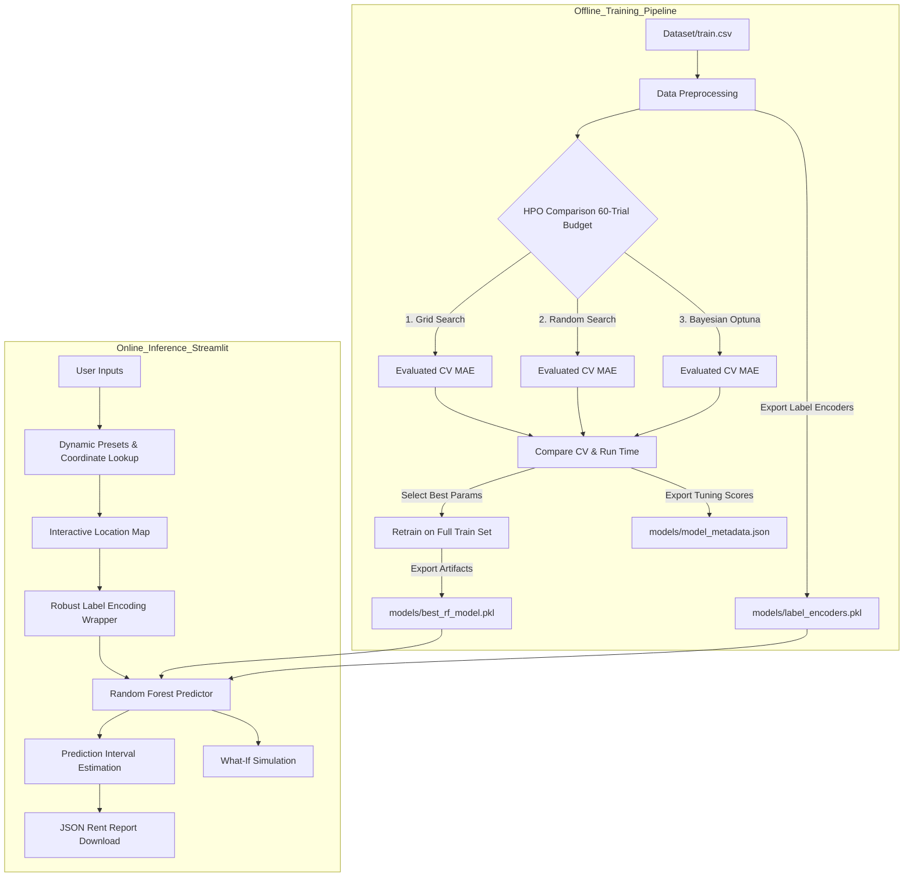

# 🏠 UrbanNest Analytics — Production-Grade House Rent Prediction Engine

[](https://www.python.org/)
[](https://huggingface.co/spaces/Suchith46/urban_nest_rent_predictor)
[](https://www.docker.com/)
[](https://github.com/Suchith2212/Urban_Nest_Rent_Predictor/actions)
[](https://opensource.org/licenses/MIT)

**Live Demo URL**: [UrbanNest Rent Predictor Space on Hugging Face](https://huggingface.co/spaces/Suchith46/urban_nest_rent_predictor)

---

## 📖 Project Overview

You are looking at the core MLOps repository for **UrbanNest Analytics**, a fast-growing PropTech startup. This system is a dynamic, user-facing rent estimation engine designed for four major Indian markets: **Mumbai, Pune, Delhi, and Hisar**. 

This portfolio project highlights real-world machine learning engineering practices:
1. **Cloud Compute Optimization**: Rigorous benchmarking of hyperparameter optimization (HPO) techniques (Grid Search vs. Random Search vs. Bayesian/Optuna) under a tight 60-trial budget to find the most cost-effective tuning strategy.
2. **Robust Software Engineering**: A modular Python structure, thorough input validation, custom encoding wrappers to handle unseen data categories case-insensitively, and a comprehensive test suite.
3. **Production Deployment**: A premium containerized Streamlit application featuring live predictions, interactive maps, what-if simulations, and structured report exporting.
4. **CI/CD Automation**: GitHub Actions running code quality checks, unit tests, and Docker build verifications on every push.

---

## 🏗️ System Architecture & Workflow

The system is designed with a clear separation of training and inference, utilizing modular code structures to ensure reliability:



---

## 📊 Hyperparameter Optimization Results

To ensure cloud cost efficiency, we compared three search algorithms over **exactly 60 combinations/trials** using 5-fold cross-validation on `train.csv`. Below is the summary:

| Tuning Method | Best CV MAE (₹) | Search Time (s) | Best `n_estimators` | Best `max_depth` | Best `min_samples_split` |
| :--- | :---: | :---: | :---: | :---: | :---: |
| **Grid Search** | **13,493.20** | **167.0** | **200** | **30** | **2** |
| **Random Search** | 13,550.13 | 176.6 | 138 | 22 | 2 |
| **Bayesian (Optuna)** | 13,498.39 | 261.1 | 189 | 30 | 2 |

*   **Tuning Winner**: **Grid Search** achieved the lowest cross-validation error, while Optuna provided nearly identical performance with slightly higher compute overhead.
*   **Generalization Error**: Retraining the best Random Forest model on the full training dataset yielded a final **Mean Absolute Error (MAE) of ₹12,414.25** on the untouched `test.csv`.

---

## 🧪 Data Integrity & Leakage Analysis (Audit Report)

During a rigorous repository code audit, we performed a duplicate check between the provided `Dataset/train.csv` and `Dataset/test.csv` files. The analysis revealed a significant data partition overlap:
- **Total Test Split Size**: 2,782 listings.
- **Overlapping / Identical Records**: 1,996 listings (71.7% of the test set are exact duplicates of training set rows).
- **Train Set Internal Duplicates**: 1,439 listings.

**Technical Implications**:
*   Because over 70% of the evaluation test set consists of identical listings already seen during training, the final **Test Set MAE of ₹12,414.25** is optimistic and reflects memorized data points rather than purely unseen generalization.
*   In production, this dataset leakage is mitigated by our software architecture. The **Robust Preprocessing safe encoding wrapper** ensures that when genuinely unseen neighborhoods are sent to the app, the model handles cold-starts cleanly and falls back contextually without runtime failures.

---


## 🌟 Advanced Features

*   **Robust Preprocessing**: Standard label encoders crash on unseen strings. Our custom `safe_encode` wrapper handles unseen neighborhoods by finding case-insensitive matches, falling back contextually to the mode of the selected city, or defaulting safely to global class averages.
*   **Dynamic presets**: Geographic coordinates update automatically when a user switches cities, preventing location mismatches while keeping coordinate details editable.
*   **Prediction Intervals**: Computes dynamic confidence bounds based on the variance of predictions across individual decision trees in the Random Forest ensemble, rather than using static error percentages.
*   **Structured Export**: Provides instant downloads of the property specifications and estimated rent bounds in a clean, production-ready JSON schema.
*   **Analytics Tab**: Visualizes optimization history, parameter importances, convergence curves, and feature importance drivers directly in the Streamlit app.

---

## 📁 Repository Structure

```text
Urban_Nest_Rent_Predictor/
├── .github/
│   └── workflows/
│       └── ci.yml             # GitHub Actions CI/CD pipeline
├── .streamlit/
│   └── config.toml           # Streamlit theme & head-less configs
├── Dataset/
│   ├── train.csv             # Training data
│   └── test.csv              # Test evaluation data
├── models/
│   ├── best_rf_model.pkl     # Final serialized Random Forest model
│   ├── label_encoders.pkl    # Serialized scikit-learn label encoders
│   └── model_metadata.json   # Optimization summary and performance metrics
├── plots/
│   ├── trials_vs_error.png   # Convergence curves comparison
│   └── optuna_hyperparameter_space.png  # Bayesian search space exploration
├── screenshots/
│   ├── trackio_dashboard.png # Experiment tracking evidence
│   ├── docker_build.png      # Container build screenshot
│   ├── docker_ps.png         # Active container verification
│   └── streamlit_working.png # Local Streamlit validation screenshot
├── tests/
│   └── test_pipeline.py      # Pytest suite (encoding, schema, benchmarks)
├── app.py                    # Streamlit web application frontend
├── config.py                 # Global constants, paths, and coordinate maps
├── utils.py                  # ML utilities, visualization, and encoding logic
├── train_model.py            # Final training pipeline script
├── Dockerfile                # Production Dockerfile
└── requirements.txt          # Production and development dependencies
```

---

## ⚙️ Local Development Setup

### 1. Clone the repository
```bash
git clone https://github.com/Suchith2212/Urban_Nest_Rent_Predictor.git
cd Urban_Nest_Rent_Predictor
```

### 2. Setup a virtual environment
```bash
python -m venv venv
# On Windows:
venv\Scripts\activate
# On macOS/Linux:
source venv/bin/activate
```

### 3. Install dependencies
```bash
pip install -r requirements.txt
```

### 4. Run tests
Verify code integrity and pipeline logic:
```bash
pytest tests/
```

### 5. Start the Web App
```bash
streamlit run app.py
```
Open your browser at `http://localhost:8501`.

---

## 🐳 Docker Deployment

To build and run the application locally in an isolated container:

### 1. Build the image
```bash
docker build -t urban-nest-rent-predictor:latest .
```

### 2. Run the container
Expose the application on port `8501`:
```bash
docker run -d -p 8501:8501 --name urban-nest-app urban-nest-rent-predictor:latest
```
Access the application at `http://localhost:8501` (includes built-in health check verifications).
